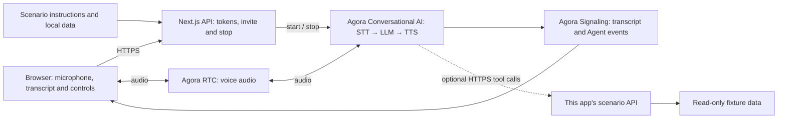

# Aster Power Adapter Support

Troubleshoot an adapter fault or explain a missing replacement part.

[Try locally](#2-try-the-demo) · [Source on GitHub](https://github.com/littleDogWang/01-consumer-support) · [Build with AI](#build-with-ai)

TypeScript · Web · Next.js 16 / React 19 · Agora Conversational AI

## 1. Overview

A voice after-sales assistant for the fictional Aster Note 15 laptop and Aster Power 65 adapter set. It handles two concrete calls: an adapter that stopped working and a delivered replacement missing its detachable wall power cord.

- Safety-first adapter checks that stop for damage, unusual heat, smoke or a burning smell.
- Exact-match sample order lookup with separate warranty and replacement-shipment facts.
- Correction-friendly conversations and a clear next step for human handling.

**Default conversation:** Product instructions and the fixed AG-1001, AG-1002 and AG-1003 records enter the prompt. The assistant does not query a live order system.

**With business tools enabled:** The read-only `lookup_order` REST tool retrieves the local order API response. Inline order records are omitted, and failed lookups cannot fall back to remembered fixtures.

**Scope:** No ticket, replacement request, callback, shipment or actual transfer is created. Warranty status does not establish a warranty duration, repair price or entitlement to free service.

## 2. Try the Demo

Run [Quick Start](#5-quick-start), open [http://localhost:3000](http://localhost:3000), allow microphone access and choose **Start product support**. A voice session starts only after your action. The Agora project must be configured even in default conversation mode; “local data” does not mean offline speech or a local LLM.

| Try | Say | Expected behavior |
| --- | --- | --- |
| Adapter fault | My Aster Note 15 power adapter stopped working. My order is AG-1001. | Safety checks precede external connection checks; the recorded warranty status is kept separate from service promises. |
| Missing replacement part | My replacement arrived without the wall power cord. My order is AG-1003. | It compares the expected adapter-and-cord set with the adapter-only shipped record, then confirms what you received. |
| Correct a detail | Please slow down. I said AG-1003, not AG-1001. | It accepts the correction, shortens turns and uses the correct record without restarting unrelated troubleshooting. |

Rows that describe tool actions require the optional public HTTPS tool configuration. In default mode, expect the limitations described above. These are acceptance cases to try, not a claim that a live voice run has passed. For the full scenario matrix, see [acceptance.md](docs/scenario/acceptance.md).

## 3. Architecture & Tech Stack



| Component | Role |
| --- | --- |
| Agora RTC | Carries user microphone audio and synthesized Agent speech. |
| Agora Signaling (RTM) | Delivers transcript, Agent state, metrics and error events to the browser. |
| Agora Conversational AI | Runs the managed voice pipeline and configured business tools. |
| Next.js route handlers | Keep the App Certificate server-side, issue combined RTC/RTM tokens and manage Agent sessions. |
| Scenario modules | Supply instructions, demo data and the optional business API/tool contracts. |

The client uses `agora-rtc-react`, `agora-rtc-sdk-ng`, `agora-rtm` and `agora-agent-client-toolkit`; the server uses `agora-agents`. The configured pipeline is Deepgram nova-3 → OpenAI gpt-4o-mini → MiniMax speech_2_6_turbo with English speech. See [the invite route](app/api/invite-agent/route.ts) and [runtime profile](lib/runtime-profile.ts) when changing providers. No separate vendor API key is required for the default Agora-managed configuration.

## 4. Prerequisites & Configuration

- Node.js 22 or newer and pnpm 9.15.9.
- An Agora project with its App Certificate enabled, and access to RTC, Signaling and Conversational AI.
- Access to this repository. Cloning or sharing the source requires appropriate repository permissions.
- A browser with microphone access; use HTTPS for a hosted app.

| Variable | Required? | Where / purpose |
| --- | --- | --- |
| `NEXT_PUBLIC_AGORA_APP_ID` | Required | App ID from your Agora Console project. |
| `NEXT_AGORA_APP_CERTIFICATE` | Required | App Certificate from the same project; server-side only. |
| `TOP_TEN_SCENARIO_TOOL_BASE_URL` | Optional | Public HTTPS origin of this same app, reachable by Agora cloud; enables the business tools described below. |

Create or select your project in [Agora Console](https://console.agora.io/), copy the App ID and enable/copy its App Certificate. Put them in `.env.local` using [env.local.example](env.local.example). Never prefix the certificate with `NEXT_PUBLIC_`, put it in client code or commit it.

Leave `TOP_TEN_SCENARIO_TOOL_BASE_URL` unset for the default conversation. To enable tools, deploy the same app at a reachable public HTTPS origin, set that variable on the server, restart/redeploy and start a fresh conversation. HTTP, localhost/private origins, malformed URLs and URLs with credentials, query or fragment are rejected. URL validation does not establish actual cloud reachability. In tool mode, a failed call must not be disguised as a successful fixture-based action.

## 5. Quick Start

From a terminal, clone this scenario rather than the generic starter:

```bash
git clone https://github.com/littleDogWang/01-consumer-support.git
cd 01-consumer-support
pnpm install --frozen-lockfile
cp env.local.example .env.local
```

Edit `.env.local` and fill the two required Agora values from section 4. Then run these commands from the cloned repository root:

```bash
pnpm run doctor
pnpm run dev
```

Alternatively, if the [Agora CLI](https://github.com/AgoraIO/cli) is already installed, bind your project with `agora login`, `agora quickstart env write . --template nextjs --project <your-project> --json` instead of manually copying credentials. Use your actual project identifier in place of `<your-project>`.

Open [http://localhost:3000](http://localhost:3000), choose **Start product support**, allow the microphone and try the first conversation above. Check that you can hear the assistant and see both speakers in the transcript. Then verify the scenario result under the configured mode; a transcript alone does not establish that a business action occurred.

## 6. How It Works

| User step | Assistant / application behavior | Result |
| --- | --- | --- |
| Describe a faulty adapter or missing part | Choose the matching product-support flow. | A targeted safety question or missing-component check. |
| Supply the exact order ID | Use inline records by default, or call lookup_order when configured. | Known warranty and replacement facts; unknown IDs stay unresolved. |
| Confirm the received contents or check result | Explain the next human-handling step. | Guidance only, without a fabricated replacement submission. |

### Tools and result semantics

`lookup_order` sends `order_id` to `POST /api/scenarios/01-consumer-support/lookup-order`. AG-1001 is in warranty, AG-1002 is expired, and AG-1003 has delivered replacement AST-R3001 with an expected wall cord missing from the shipped-contents record. The customer's received contents remain a separate statement.

The invite body contains `requester_id` and `channel_name`. The supplied browser already handles this startup sequence. See [the scenario guide](docs/scenario/README.md) for additional behavior and contracts.

## 7. Customize for Your Business

| Change | Source | How |
| --- | --- | --- |
| Product and support steps | [product.ts](lib/consumer-support/product.ts) | Replace the Aster facts, safety questions and missing-part flow. |
| Sample orders | [orders.json](lib/consumer-support/orders.json) | Replace fixed orders and optional replacement fields; do not infer a shipment from warranty status. |
| Assistant behavior | [config.ts](lib/agent-config.ts) | Change role, greeting, voice style and escalation guidance. |

To use your own order service, replace the lookup-order route's fixture lookup with your authenticated read API while preserving the tool response shape. Test a covered order, an expired order and an unknown ID. Add shipping or replacement writes only as new, explicitly confirmed actions.

Shared integration points:

- [lib/agent-config.ts](lib/agent-config.ts) assembles the selected scenario prompt.
- [lib/agent-tools.ts](lib/agent-tools.ts) defines business tool schemas and server-bound routes.
- [app/api/invite-agent/route.ts](app/api/invite-agent/route.ts) selects the prompt, providers, turn detection and session settings.
- [lib/presentation.ts](lib/presentation.ts) selects the scenario presentation; edit its scenario module for visible content.
- [docs/ai/RECIPE.md](docs/ai/RECIPE.md) retains the machine-readable integration profile and lifecycle contracts.

Keep combined RTC/RTM token generation, the StrictMode initialization guard, toolkit local-user UID remapping and interrupted transcript turns intact. Let the Agora React hooks own microphone and RTC teardown. Preserve server-bound business session scope when extending tools.

### Build with AI

After cloning this repository, paste the following into your coding agent from your own application workspace, providing the path to the clone:

```text
Implement the Aster Power Adapter Support recipe in my application.

Read RECIPE.md in the cloned 01-consumer-support repository first, then inspect
its scenario modules, tool contracts and invite route. Read docs/ai/RECIPE.md
and AGENTS.md in that repository for integration constraints.

Inspect my application's existing stack and instructions before editing.
Reuse the source's RTC/RTM token, session and transcript patterns.
Implement the scenario's default conversation first, then connect only the
business tools I request. Keep demo data and real service results distinct.
Explain the credentials and configuration I need to supply.
Ask before adding dependencies. Follow my rules for local edits, verification,
commits and remote writes. Verify the result without claiming unrun live tests.
```

This prompt is a source-guided integration entry point, not a published scaffolding package or an automatic Console import.

## 8. Deployment & Validation

### Deploy

A single Next.js deployment can serve the voice app and read-only fixture API. No writable business store is required. This sample order endpoint is not customer authentication or a real manufacturer service.

Install dependencies and set the same required environment variables in your deployment platform's secret store. Build with `pnpm run build` and, on a Node host, start with `pnpm run start`. Keep the public app on HTTPS. For voice tools, set `TOP_TEN_SCENARIO_TOOL_BASE_URL` to the deployed app's reachable HTTPS origin and verify cloud callbacks against that same running instance.

These commands describe the repository's supported scripts; they do not attest to an existing deployment. Before opening sample endpoints to real users, add application authentication, authorization and appropriate request limits.

### Docker deployment

```bash
docker build --build-arg NEXT_PUBLIC_AGORA_APP_ID=YOUR_AGORA_APP_ID -t 01-consumer-support:local .
docker run --rm -p 3000:3000 --env-file .env.local 01-consumer-support:local
```

Replace `YOUR_AGORA_APP_ID` with the public App ID used in `.env.local`. Next.js embeds that identifier in the browser bundle, so changing projects requires rebuilding the image. The App Certificate is supplied only at container runtime. A container restart does not preserve process memory. This image does not add a shared state service.

`pnpm run verify:docker` independently builds the image with synthetic credentials, starts an isolated localhost-bound container, checks the home page and a scenario route, then removes only that container. It does not contact Agora or prove a live voice session.

### Check locally

From this repository root:

```bash
pnpm run verify:template
pnpm run lint
pnpm run typecheck
pnpm run verify:api
pnpm run verify:scenario
pnpm run build
```

With the local prerequisites and credentials configured, also run `pnpm run verify`. The canonical verify script includes all of the local scenario checks above; Docker is deliberately verified separately. Local checks do not require a real microphone call and do not prove cloud tool execution.

### Verify a real conversation

1. Start a fresh voice session; check two-way audio and both transcript speakers.
2. Try the normal, correction and unsupported/failure paths in section 2.
3. Compare AG-1001 and AG-1003, try an unknown order and request a human. Verify that no replacement, callback or transfer is described as completed.
4. End the call and confirm that microphone publication and the Agent session stop. Keep evidence of the actual result separately from the transcript.

### Troubleshooting

| Symptom | Check |
| --- | --- |
| Agent does not join | Check the token/invite response and run pnpm run doctor. If using the Agora CLI, run agora project doctor --deep. |
| Audio works but transcript is missing | Check RTM login/subscription and keep RtcTokenBuilder.buildTokenWithRtm in the token route. |
| Browser has no microphone | Grant permission, select an input device and use localhost or a secure HTTPS page. |
| The assistant discusses the task but does not save or change it | Check whether the optional public tool origin is enabled. The default conversation has the limits in section 1. |
| A tool fails or a result disappears | Inspect the actual API error, callback reachability and this scenario's storage/lifetime limits; do not claim success from speech alone. |

See [the contributor guide](AGENTS.md), [scenario guide](docs/scenario/README.md) and [MIT License](LICENSE) for further details.
